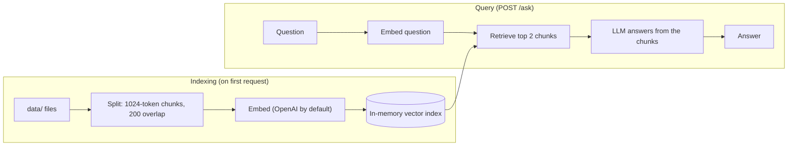

# ai-rag-template

[](https://github.com/yakim-nick/ai-rag-template/actions/workflows/ci.yml)

A small Retrieval-Augmented Generation (RAG) API: put `.md`, `.pdf`, `.txt` or
`.csv` files in `data/`, ask questions over HTTP (FastAPI) or in a Streamlit UI,
and get answers that LlamaIndex builds from the retrieved document chunks.

It is a learning project, not a production service. See
[Known limitations](#known-limitations).

## How it works



- The index is built lazily on the first `/ask` and kept in memory. It is **not
  persisted**, so it is rebuilt (and re-embedded, which costs API calls) after
  every restart.
- Embeddings and the LLM are LlamaIndex's defaults, which use OpenAI. You need
  `OPENAI_API_KEY`.

## Components

- `app.py`: FastAPI service. `POST /ask`, `GET /health`. The engine is injected as a
  dependency, so tests run with a fake engine.
- `rag.py`: builds the LlamaIndex query engine from a directory.
- `services.py`: `generate_answer(engine, question)`.
- `eval.py`: manual faithfulness check (see [Evaluation](#evaluation)).
- `ui/app.py`: Streamlit chat UI with document upload.
- `data/`: documents to index. `data/terraform-vpc.md` is a small sample.
- `tests/`: 27 tests, no network or API key needed.

## Run (API)

```bash
python -m venv .venv && source .venv/bin/activate
pip install -r requirements.txt
cp .env.example .env            # then put your real key in .env
export OPENAI_API_KEY=sk-...    # the API reads the environment, not .env
uvicorn app:app --port 8000
curl -X POST localhost:8000/ask -H 'Content-Type: application/json' \
  -d '{"question":"How do I create a VPC with Terraform?"}'
```

Responses: `200 {"answer": ...}`, `422` for a blank or over-long (> 1000 chars)
question, `503` if the engine cannot be built (missing key, unreadable `data/`),
`502` if the model call fails. Error bodies do not include upstream details.

## Streamlit UI

```bash
streamlit run ui/app.py         # http://localhost:8501
```

Upload `.md/.pdf/.txt/.csv` files (max 10 MB, file names are sanitised so they
stay inside `data/`), browse indexed documents and chat. The UI builds its own
engine in-process; it does not call the API.

## Docker

```bash
docker compose up --build       # api on :8000, ui on :8501, reads .env
```

## Evaluation

`python eval.py` scores answers with RAGAS faithfulness against a threshold of
0.8. **It is a manual script, not part of CI**, and today it scores one
hard-coded placeholder example rather than answers produced by this engine. It
also needs `OPENAI_API_KEY`. Replacing the placeholder with real engine output
is on the Roadmap.

## Tests and CI

```bash
pip install ruff && ruff check . && python -m pytest -q
```

CI (`.github/workflows/ci.yml`) runs `ruff` and `pytest` only, with a read-only
token and actions pinned to commit SHAs. Dependabot is enabled.

## Known limitations

- No authentication or rate limiting on `/ask`: anyone who can reach it spends
  your OpenAI credits. Do not expose it publicly as is.
- The index is in memory only and is built on the first request (slow first call).
- Answers are not checked for faithfulness at runtime or in CI (see Evaluation).
- `requirements.txt` is unpinned and lists `chromadb`, which is not used yet.
- The Docker images run as root and have no healthcheck.

## Roadmap

- Evaluate real engine answers on a small English golden set and report the score.
- Persist the index (for example Chroma, which is already a dependency).
- Pin dependencies, non-root Docker images with healthchecks, API key auth.

## Author

Nick Yakim: [github.com/yakim-nick](https://github.com/yakim-nick)
